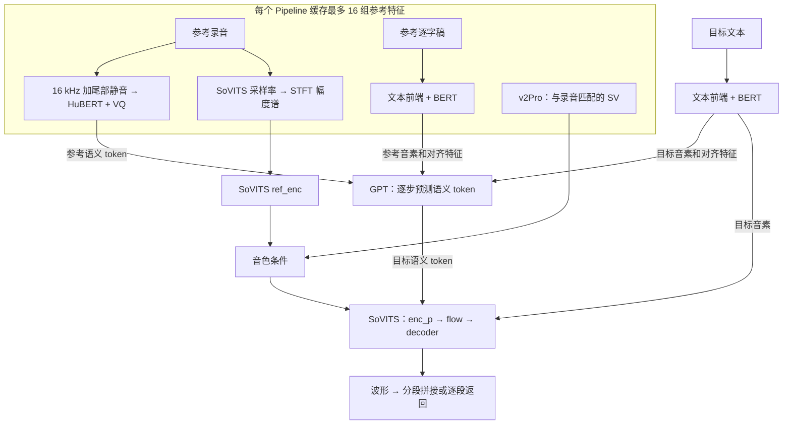

# GPT-SoVITS Rust 实现说明

本文说明 Rust 推理链路和模块职责。
操作步骤见 [API](docs/API.md) 和 [模型指南](docs/MODELS.md)，代码目录与测试见
[开发指南](docs/DEVELOPMENT.md)。

## 推理流程

一次请求有两组输入：参考录音和逐字稿决定用谁的声音，目标文本决定这次读什么。相同音色再次请求时，可复用参考特征，只为新的句子准备目标特征。

参考音色通过 `ref_enc` 编码，`enc_q` 用于训练时的 posterior encoder。
代码中的 `ref_mel` 名称沿用历史，实际输入是 STFT 幅度频谱。

### 跟一次请求读源码

| 步骤 | 从这里读 | 看什么 |
| --- | --- | --- |
| 1. 收到 HTTP 请求 | [路由处理](src/server/handlers.rs) → [模型缓存与排队](src/server/pipeline_registry.rs) | 音色如何选中模型对？多个请求如何共用一个推理槽？ |
| 2. 准备参考音色 | [参考缓存](src/inference/speaker.rs) → [HuBERT](src/models/hubert.rs) / [参考频谱](src/inference/ref_audio.rs) | 哪些特征只算一次？为什么同一段录音要走两条路径？ |
| 3. 准备目标文本 | [文本前端](src/text_frontend/mod.rs) → [GPT 条件准备](src/models/gpt/conditioning.rs) | 数字和注音如何变成音素？`word2ph` 怎样把 BERT 特征对齐到音素？ |
| 4. 生成语义 token | [解码](src/models/gpt/decode.rs) → [采样](src/models/gpt/sampling.rs) / [CUDA Graph](src/models/gpt/cuda_graph.rs) | 何时允许结束，何时值得捕获 Graph？首次回放如何验证？ |
| 5. 合成波形 | [Pipeline 加载与合成](src/inference/mod.rs) → [SoVITS](src/models/sovits.rs) → [内置解码器](src/models/sovits_decoder.rs) | 如何复用权重、组合音色条件？改动可对照 [SoVITS 单测](src/models/sovits/tests.rs)和 [GPT 契约测试](src/models/gpt/contracts.rs)。 |

## 文本和参考特征

[speaker.rs](src/inference/speaker.rs) 负责参考缓存和目标特征准备。
文本前端解析注音、判断语言、展开数字，再生成音素和 `word2ph`；
BERT 特征按相同文本对齐到音素位置。
参考/目标的音素与对齐后的 BERT 特征分别拼接后送给 GPT。
G2P 与 BERT 使用同一份规范化文本，数字展开和读音覆盖通过原文索引映射保持一致。
数字与注音规则见 [Agent 接入](docs/AGENT_INTEGRATION.md#读音和数字)。

[HuBERT](src/models/hubert.rs) 使用 soxr 重采样到 16 kHz，并追加 9600 个零样本。
已经是 16 kHz 的输入也追加静音。另一条参考路径在
[ref_audio.rs](src/inference/ref_audio.rs) 计算 SoVITS 频谱（FFT 2048、hop 640）。
当前参考编码器使用前 704 个频率 bin。

[GPT 条件准备](src/models/gpt/conditioning.rs) 对 BERT 特征去除 CLS/SEP，投影到 512 维并根据 `word2ph` 展开。
非中文及无法直接对齐的情形使用回退处理。

每个 Pipeline 最多缓存 16 组参考特征，键包含参考音频路径、参考文本、参考语言和 SV 路径。
参考语言独立于目标语言；只切换待朗读文字的语言可以复用参考特征。
原地修改文件后，需要更换路径、清理缓存或重启来刷新特征。

## GPT 解码

| 模式 | 行为 |
| --- | --- |
| `plain` | 每一步重新计算完整前缀，主要用于对照 |
| `kv` | Prefill 后缓存历史 K/V，每步只输入新 token；attention 仍需访问历史缓存 |
| `cuda-graph` | 静态 KV 加 CUDA Graph，减少 decode 的主机调度开销 |
| `auto` | CUDA F32 默认 Graph，其他设备默认 KV |

v1.3.3 的 Graph 路径先做 32 步 eager/static KV。当前实现让 prefill 先采样一个 token，
再用静态 KV 解码至多 11 步；在首次允许 EOS 时已经结束的短句无需 capture。首次 replay 做结果检查，
出现不适用情形时有 KV 回退保护。每次生成分别创建 Graph。
`GPT_SOVITS_DISABLE_CUDA_GRAPH=1` 让自动选择退回 KV；旧的 experimental 开关已删除。

各后端共用[输入准备](src/models/gpt/conditioning.rs)：Prefill 使用文本双向、音频因果的
hybrid mask；单步 decode 可看到所有有效历史缓存。
[DecoderSampler](src/models/gpt/sampling.rs) 统一前 11 步的 EOS 屏蔽，以及
argmax 或采样结果为 EOS 时停止的判断，并保持停止前的 RNG 消耗顺序。
提前结束或漏读的样本通过分段日志、ASR 和试听排查。

`GPTModel` 的公开类型和方法位置保持不变；内部模块职责与独立测试入口见
[GPT Core](docs/DEVELOPMENT.md#gpt-core)。历史无参考 semantic tokens 的生成器保留在
`legacy.rs`，Pipeline 进入该兼容路径时记录警告。

## SoVITS 和 v2Pro

`Pipeline::load_sovits` 为模型和参考语义 tokenizer 共用一次读取的权重。
两者都加载成功后才替换现有模型，并清空参考缓存。

[sovits.rs](src/models/sovits.rs) 根据权重是否包含 `sv_emb.*` 等层加载 v2Pro 条件分支。
SV 接受 `[20480]` 或 `[1, 20480]`，应与参考音频匹配。
缺少 SV 时使用零向量。性能和发布验收使用与参考音频匹配的 SV。
Rust 转换器可转换已有 embedding，不负责从参考录音计算新的 SV。

EncP 的 attention/FFN 使用 post-norm：`LayerNorm(x + block(x))`。
Flow 的 gate 先做 `a + b` 再分通道执行 tanh/sigmoid。
普通 Conv1d 权重由共享加载器原样缓存，保留权重幅度和零值通道；`weight_g` / `weight_v`
形式仍使用 weight normalization。Flow 投影与训练用 EncQ 的普通卷积共用该加载器。
CUDA 的两倍最近邻上采样通过高度为 1 的二维张量调用 Candle 现有算子，激活留在设备上；
CPU 路径保持一维上采样。
声码器使用项目内的 SoVITS decoder。BigVGAN 尚未接入主推理路径，v3/v4 尚未支持。

[Config](src/config/mod.rs) 当前把 GPT 与 SoVITS 保持在 F32；`--half` 为兼容选项。
CUDA 不可用时普通配置可能回落 CPU。发布 GPU 基准会显式拒绝这种回落。
依赖版本以 [Cargo.toml](Cargo.toml) 和 [Cargo.lock](Cargo.lock) 为准。

## 服务和验收边界

HTTP 服务共享 BERT/HuBERT，按 GPT/SoVITS 模型对维护有界 LRU（默认两个 Pipeline），
并通过一个推理槽串行处理请求，其余请求排队。
`/tts/stream` 接收完整文本，逐段输出音频；协议见 [API](docs/API.md)。

模型无关测试覆盖文本、配置、缓存、请求和报告处理。真实模型验证需要显式执行
[发布验收](docs/RELEASE_ACCEPTANCE.md) 与 [GPU 基准](docs/PERFORMANCE.md)。
