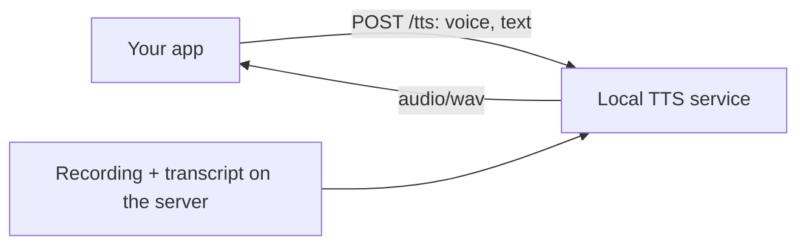

# GPT-SoVITS-RS

<p align="center">
  
</p>

**Local text-to-speech for Chinese and English, written in Rust.**

Give GPT-SoVITS-RS a short recording and its transcript. It can then read new
text in that voice, from the command line or over HTTP. No Python runtime is required.

[Listen](#samples) | [Run locally](#quick-start) | [Connect an app](#connect-your-app) | [Chinese quick start](docs/FIRST_RUN.zh-CN.md)

## Samples

| Voice | Text | Audio |
| --- | --- | --- |
| English demo (the voice you'll run below) | Your local voice service is ready. All speech is generated on your own computer. | [Demo WAV](examples/samples/local-assistant-en.wav) |
| Sun (private v2Pro voice) | 你好，欢迎回来。今天有什么想和我聊聊的吗？ | [Sun WAV](examples/samples/sun-greeting.wav) |

[Play the Sun samples in your browser](https://ricardomlee.github.io/gpt-sovits-rs/) · [Recordings and settings](examples/samples/README.md)

## Quick Start

On Linux x86_64, the demo runs on CPU using Docker Engine with Compose v2.
You'll need Git, Bash, curl, SHA-256 tools, 6 GiB free disk and 4 GiB available
memory. The [setup script](examples/first-run/prepare.sh) downloads about 1.1 GB
of [model files](examples/first-run/downloads.txt) plus the `1.3.3` CPU image.
For Mac, ARM Linux or CUDA, [choose a build for your machine](docs/AGENT_INTEGRATION.en.md#choose-a-build).

Let the script create `~/gpt-sovits-demo` in your home directory, or give it an empty directory.
The demo listens on localhost, on port `9881` by default.

```bash
git clone https://github.com/ricardomlee/gpt-sovits-rs.git
cd gpt-sovits-rs
bash examples/first-run/prepare.sh "$HOME/gpt-sovits-demo"
cd "$HOME/gpt-sovits-demo"
docker compose up -d --wait --wait-timeout 900
export TTS_URL="http://127.0.0.1:${DEMO_PORT:-9881}"
```

From the same directory, generate the English demo:

```bash
curl --fail-with-body --max-time 300 "$TTS_URL/tts" \
  -H 'Content-Type: application/json' --data-binary @request.json \
  --output first.wav
```

Play `first.wav`. To hear another sentence, change `text` in `request.json`
to your own English line and repeat just the `curl` command. Use
`--output reply.wav` to keep both recordings.
To change the speaker, [add your own voice](docs/AGENT_INTEGRATION.en.md#add-a-voice).
When you're finished, run `docker compose down` in the demo directory. Your model files stay there.

## Connect Your App

An app sends JSON to `POST /tts` and receives WAV audio. From the machine
running the app, set `TTS_URL` to your server and pick a name from `/voices`.
For the English `demo`:

```bash
TTS_URL=${TTS_URL:-http://127.0.0.1:9880}
curl -fsS --max-time 5 "$TTS_URL/voices"
curl --fail-with-body --max-time 300 "$TTS_URL/tts" \
  -H 'Content-Type: application/json' \
  -d '{"voice":"demo","text":"The backup is complete."}' --output reply.wav
```



[Connect Hermes](docs/AGENT_INTEGRATION.en.md#hermes) · [HTTP API](docs/API.md#http-server)

## Models and Speech Quality

- Supports **v2 and v2Pro** weights, with Chinese, English and mixed text.
- Use a clean 3-10 second reference clip and its exact transcript.
- v2Pro needs an SV embedding for the full voice-conditioning path. The released converter
  can convert an existing training embedding; it does not extract one from audio.
- For assistant replies, generate and play completed short sentences in order.
  Long text can still lose words; review important output.
- The [performance guide (in Chinese)](docs/PERFORMANCE.md) links to reports with hardware, models and repeated measurements.
- Use voices and recordings you have permission to use. To train a voice, see [upstream GPT-SoVITS](https://github.com/RVC-Boss/GPT-SoVITS); to use existing weights, see [model conversion (in Chinese)](docs/MODELS.md).

The service has no built-in authentication. Keep it on localhost or put an authenticated
proxy in front of it; the [deployment guide (in Chinese)](docs/DEPLOYMENT.md) covers network access.

## Help and Contribute

If a download stops, rerun the setup command to reuse the verified files.
If the first request fails, check `docker compose logs --tail 100` in the demo directory.
[First-run troubleshooting (in Chinese)](docs/FIRST_RUN.zh-CN.md#出错时) covers downloads, memory, ports,
and readiness. [Tell us where you got stuck, or what worked](https://github.com/ricardomlee/gpt-sovits-rs/issues/new?template=first-run.yml).
Do not attach private models, recordings, or credentials.

[API](docs/API.md) | [Development](docs/DEVELOPMENT.md) | [Chinese documentation index](docs/README.md)

## License and Credits

Code: [MIT](LICENSE). Models keep their publishers' licenses.
The public sample has [separate provenance](examples/samples/README.md).
Built on [GPT-SoVITS](https://github.com/RVC-Boss/GPT-SoVITS) and
[Hugging Face Candle](https://github.com/huggingface/candle).
