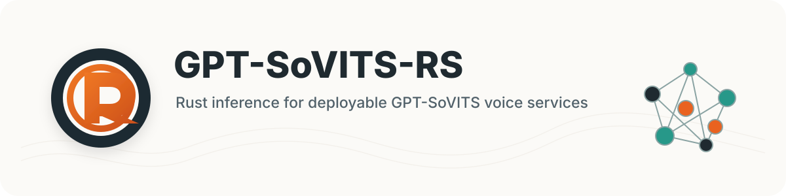
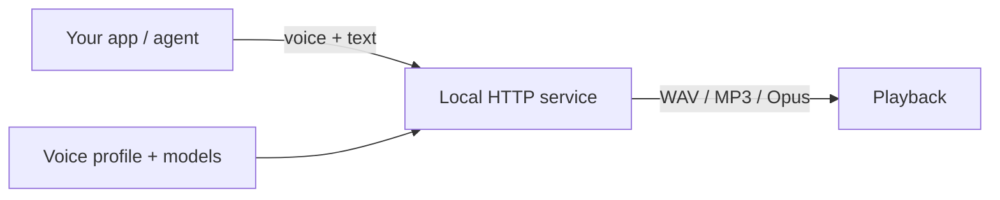

# GPT-SoVITS-RS

<p align="center">
  
</p>

**Turn GPT-SoVITS voices into a local HTTP service, without a Python runtime.**

Configure a voice once, then send its name and text from your assistant or app.
Conversion and inference run in Rust on your own computer. Train or fine-tune voices
with [upstream GPT-SoVITS](https://github.com/RVC-Boss/GPT-SoVITS).

[Try it](#quick-start) | [Listen](#samples) | [Chinese quick start](docs/FIRST_RUN.zh-CN.md) |
[Add your voice](docs/AGENT_INTEGRATION.en.md#add-a-voice) | [Connect an agent](docs/AGENT_INTEGRATION.en.md) | [API](docs/API.md)

## Samples

[Listen to Sun / download the generated WAV](examples/samples/sun-greeting.wav):

> 你好，欢迎回来。今天有什么想和我聊聊的吗？

Generated on CPU with the maintainer's **Sun v2Pro + SV** voice.
[Listen in your browser](https://ricardomlee.github.io/gpt-sovits-rs/) or download the
[service confirmation sample](examples/samples/sun-zh.wav).
[Settings and provenance](examples/samples/README.md) accompany the public audio;
the Sun model and reference files remain private. The installable demo below uses standard v2 weights.

## Quick Start

Already have a TTS endpoint? [Use the running service](docs/AGENT_INTEGRATION.en.md). For Mac, NVIDIA, or ARM, [choose a build](docs/AGENT_INTEGRATION.en.md#choose-a-build).

**CPU demo: Linux x86_64, Docker Engine + Compose v2, Git, Bash, curl, and SHA-256 tools.**
Allow at least 6 GiB free disk and 4 GiB available memory. Downloads are about
1.1 GB plus the container; conversion and the first model load take time.
No Rust, Python, API key, or GPU is needed for this CPU demo.

The [setup script](examples/first-run/prepare.sh) verifies the [upstream weights](examples/first-run/downloads.txt), converts them with the pinned `1.3.3` CPU image, and checks the setup.

```bash
git clone https://github.com/ricardomlee/gpt-sovits-rs.git
cd gpt-sovits-rs
bash examples/first-run/prepare.sh "$HOME/gpt-sovits-demo"
cd "$HOME/gpt-sovits-demo"
docker compose up -d --wait --wait-timeout 900
export TTS_URL="http://127.0.0.1:${DEMO_PORT:-9881}"
curl --fail-with-body --max-time 300 "$TTS_URL/tts" \
  -H 'Content-Type: application/json' --data-binary @request.json \
  --output first.wav
```

Play `first.wav` with your usual audio player. The demo uses its own directory,
Compose project, and **localhost-only port 9881**, without changing a service on 9880.
Stop it with `docker compose down` in the demo directory; downloaded files stay there.
Use a new directory for preparation. If interrupted, rerun the same command:
verified downloads are reused.

Next, [add your own voice](docs/AGENT_INTEGRATION.en.md#add-a-voice) with a reference clip and transcript.
The standard v2 demo can reuse its weights. For fine-tuned weights, see [model conversion (in Chinese)](docs/MODELS.md).

## Connect Your App



Follow [Connect an agent](docs/AGENT_INTEGRATION.en.md) to list voices, speak a sentence, and connect Hermes or your app to the same endpoint. The [HTTP API](docs/API.md#http-server) covers streaming and batch requests.

## Models and Speech Quality

- Supports **v2 and v2Pro** weights, with Chinese, English and mixed text.
- A clean 3-10 second reference clip and matching transcript are still required.
- v2Pro needs an SV embedding for the full voice-conditioning path. The released converter
  can convert an existing training embedding; it does not extract one from audio.
- For assistant replies, generate and play completed short sentences in order.
  Long text can still lose words; review important output.
- The [performance guide (in Chinese)](docs/PERFORMANCE.md) links to reports with hardware, models and repeated measurements.
- Models are not bundled or rehosted. Only use voices and recordings you have permission to use.

The service has no built-in authentication. Keep it on localhost or put an authenticated
proxy in front of it; the [deployment guide (in Chinese)](docs/DEPLOYMENT.md) covers network access.

## Help and Contribute

If the first request fails, check `docker compose logs --tail 100` in the demo directory.
[First-run troubleshooting (in Chinese)](docs/FIRST_RUN.zh-CN.md#出错时) covers downloads, memory, ports,
and readiness. [Tell us where you got stuck, or what worked](https://github.com/ricardomlee/gpt-sovits-rs/issues/new?template=first-run.yml).
Do not attach private models, recordings, or credentials.

[API](docs/API.md) | [Development](docs/DEVELOPMENT.md) | [Chinese documentation index](docs/README.md)

## License and Credits

Code: [MIT](LICENSE). Models keep their publishers' licenses.
The public sample has [separate provenance](examples/samples/README.md).
Built on [GPT-SoVITS](https://github.com/RVC-Boss/GPT-SoVITS) and
[Hugging Face Candle](https://github.com/huggingface/candle).
