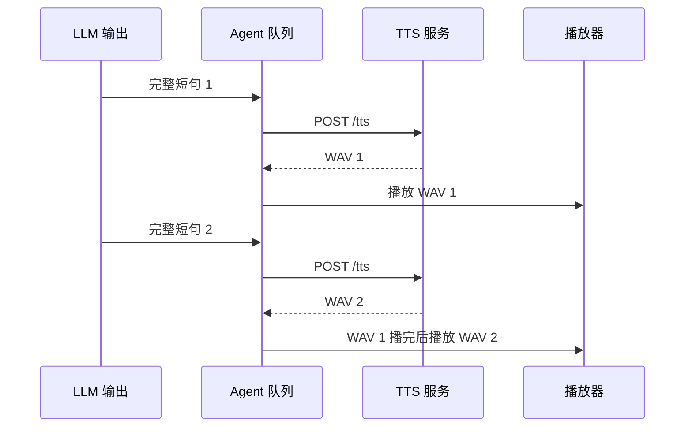

# Agent 接入

[英文接入指南](AGENT_INTEGRATION.en.md)

## 最小调用

**1. 检查已有服务。** 在 Agent 所在环境运行。将 `TTS_URL` 设为实际服务地址：正式部署默认端口是 `9880`，首次体验是 `9881`。容器里的 `localhost` 指容器自身。

```bash
TTS_URL=${TTS_URL:-http://127.0.0.1:9880}
curl -fsS --max-time 5 "$TTS_URL/health"
curl -fsS --max-time 5 "$TTS_URL/voices"
```

返回 `OK` 和音色列表就直接用。连不上先核对地址；需要新部署时再[检查主机并选包](DEPLOYMENT.md#选择部署方式)。

**2. 试一句。** 从列表选音色，用它的语言说一句。缺少目标音色时，在现有服务上[添加音色](DEPLOYMENT.md#添加音色)。公开的 `demo` 用这句英文测试：

```bash
curl --fail-with-body --max-time 300 "$TTS_URL/tts" \
  -H 'Content-Type: application/json' \
  -d '{"voice":"demo","text":"Your local voice service is ready."}' \
  --output reply.wav
```

**3. 接入应用。** 播放 `reply.wav`，确认整句读对。[Hermes](#hermes) 等兼容 OpenAI 接口的客户端使用 `$TTS_URL/v1` 和刚验证的音色。

### 选择接口

| 调用方 | 接口 | 返回 |
| --- | --- | --- |
| 自己的工具或 Agent | `POST /tts`，发送 `voice`、`text` | 完整 WAV |
| Hermes 等兼容 OpenAI 接口的客户端 | `POST /v1/audio/speech`，发送 `voice`、`input` | WAV、PCM、MP3 或 Ogg/Opus |
| 已拿到整段文字，想边生成边播 | `POST /tts/stream` | 一个持续输出的 WAV 流 |

兼容接口的请求正文：

```json
{"model":"tts-1","voice":"demo","input":"Your local voice service is ready.","response_format":"mp3"}
```

音色决定模型；`model` 和 `instructions` 为兼容字段，当前忽略。
格式、采样率、参数覆盖和错误结构见 [HTTP API](API.md#http-server)。
仅支持外部命令的调用方可选用 [HTTP 客户端](../client/README.md)。

## Hermes

在 Hermes 所在环境中，沿用刚验证的 `TTS_URL`，把 `demo` 换成刚验证的音色：

```bash
hermes config set tts.openai.base_url "${TTS_URL:?}/v1"
hermes config set tts.openai.api_key local
hermes config set tts.openai.model tts-1
hermes config set tts.openai.voice demo
hermes config set tts.use_gateway false
hermes config set tts.provider openai
```

`api_key: local` 满足 SDK 的必填项，`use_gateway false` 让请求使用本地地址和凭据。
服务没有内置认证；跨机器部署时，通过防火墙或带认证的反向代理限制访问。
模型和录音留在服务端，这条路径无需安装 `gpt-sovits-client` 或额外调用 FFmpeg。

让 Hermes 调用 `text_to_speech`，传入一小段 `text`，检查工具结果并试听。
Hermes 每次调用都会读取语音配置，修改后可直接重试。
Hermes 默认请求 MP3；Telegram 等语音平台会请求 Opus，服务直接返回 Ogg/Opus。

要在收到语音时自动用语音回复：

```bash
hermes config set voice.auto_tts true
```

该设置位于 `voice` 下。已运行的网关可在会话中用 `/voice on` 开启，
或重启网关加载全局默认值。

分句、语速和采样参数放在服务端的 `voice.json` 中管理，完整示例见
[音色配置](DEPLOYMENT.md#音色目录)。从外部命令接入方式迁移时，
将原命令里的请求级覆盖移到音色配置；情绪和语气主要由模型及参考录音决定。

本节按 Hermes [`0a62610` 的 TTS 实现](https://github.com/NousResearch/hermes-agent/blob/0a62610f10cc34d696b2239b2c69fa1ba0f1ca63/tools/tts_tool.py)
核对。若工具被权限策略拒绝，通过 Hermes 的工具授权或管理员配置处理。

## 逐句生成和播放

如果模型以流式返回文本，Agent 收到一句完整的话就可以提交合成，按顺序播放：



合成下一句与播放上一句可以重叠。单个服务只有一个推理槽，多个合成请求会排队。
队列设上限；用户打断时停止播放并丢弃旧回复，已开始的模型加载或合成会继续到结束。
保持数字、小数、版本号和 `字[pinyin+tone]` 标注完整，避免切成一两个字的请求。

`/tts/stream` 接收完整文本，由服务端分段后输出一个未知长度 WAV。
播放端需要支持这种 WAV，并把网络块当作同一条音频流解码。
只有普通文件播放能力时，逐句调用 `/tts` 更方便。

### 失败处理

| 结果 | 调用方处理 |
| --- | --- |
| HTTP 400 | 检查文字、音色和参数后再提交 |
| HTTP 503 | 等待推理槽超时；仅对仍有效的回复做有上限的退避重试 |
| HTTP 500 | 记录错误并检查服务日志；避免自动反复合成相同失败内容 |
| 流中断或未收全 | 停止播放；HTTP 200 之后的合成错误会终止音频流 |
| 批量请求返回 HTTP 200 | 逐行检查 `error` 和 `wav_base64`，批量结果没有 `success` 字段 |

请求超时应覆盖排队、首次加载和生成。断开连接后，已开始的合成可能仍在运行；
重试也可能再次生成同一段，尤其要避免重复播放已听到的部分。
服务状态和错误结构见 [API](API.md#errors)。

## 读音和数字

只在有歧义的字后加注音，格式为 `字[pinyin+声调数字]`，1-5 表示声调，5 为轻声：

```text
这个人很好[hao4]学，银行的行[hang2]长正在重[chong2]新安排会议。
```

标注只影响前一个中文字符，方括号内容会在 BERT/G2P 对齐前移除。
其他文字仍按正常分词、G2P 和变调处理。

| 输入 | 自动展开 |
| --- | --- |
| 中文 `50%`、`3.140`、`-3.5` | 百分之五十、三点一四零、负三点五 |
| 英文 `123`、`12.5%`、`21st` | one hundred twenty three、twelve point five percent、twenty first |
| 英文 `007`、`v12` | zero zero seven、v one two |

纯数字的 `auto` 默认中文，英文读法显式传 `text_language: "en"`。
日期、时间、金额和电话的语境读法由 Agent 写成希望读出的文字，
例如“二零二六年十月二十五日”“下午三点半”“一百二十三元”。
避免让 `123元` 这样的整数默认展开承担金额语义。

参考转写语言可用 `prompt_language` 独立设置，例如中文参考读英文时用
`text_language: "en"`、`prompt_language: "zh"`。版本兼容见 [请求字段](API.md#post-tts)；
也可将参考语言固定在音色配置中，让 Agent 保持只传音色名和文字。

## 排障

先保留失败请求和音频，定位具体句子。模型或 BERT/HuBERT 特征提取失败时，
检查日志中的阶段、模型文件和参考 WAV。单段过长时先恢复按句提交。

需要在本机查看分段文字时，可临时开启：

```bash
GPT_SOVITS_LOG_CHUNK_TEXT=1 ./gpt-sovits --http --port 9880 --voice demo
```

日志包含分段序号、字数、语义标记数、时长和每秒字数。
文本日志可能含私人对话，平时保持关闭。结合试听和
[语音回归](RELEASE_ACCEPTANCE.md#speech-regression)检查漏读，再决定是否调整参数。
